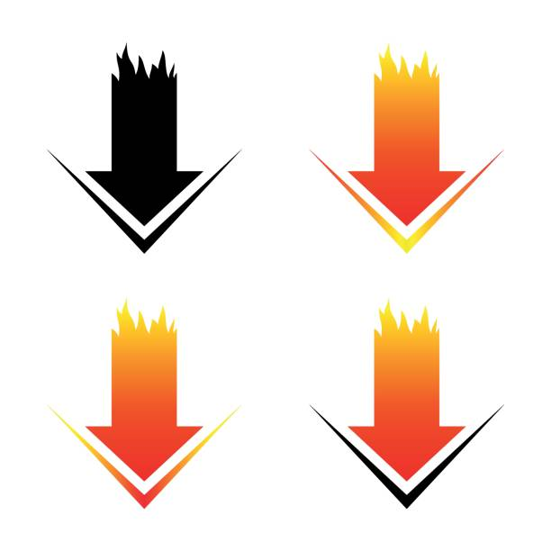

# Model Manager

**Model Manager** submits HuggingFace model downloads and NVIDIA NIM profile mirrors as Kubernetes Jobs onto a PCAI cluster's shared storage, then manages what landed — the inventory, the catalog, and the deletion path — for platform and ML teams on **HPE Private Cloud AI (PCAI / HPE Ezmeral Unified Analytics, AI Essentials)**. It deploys as Helm chart `model-manager` v2.1.2 with the images `ghcr.io/ai-solution-eng/model-manager` and `ghcr.io/ai-solution-eng/hf-downloader`.

## What it is

Model Manager is a web UI plus a FastAPI service (a Python ASGI web application) that turns "put this model on my cluster" into a tracked Kubernetes Job. A user picks a model — or a NIM image — and a target namespace in the browser; the service creates a per-submission credential Secret plus a Job, tracks it to completion, and lists what landed on the shared `models-pvc` and/or in S3. A curated model catalog pushes serving configurations straight into the MLIS/AIOLI database — MLIS being HPE's model-serving stack, AIOLI its model-registry database — which is the step that makes a model appear in MLIS model serving. The chart, Python package, container images, Kubernetes identifiers and UI host are all `model-manager`; the legacy `model-downloader/*` labels and annotations written by older releases are still accepted on read while they are phased out.

## The problem it solves

- **You need HF models on an air-gapped or proxied cluster, and end users must not touch `kubectl`.** A UI submission creates the Job and its credentials in the user's own namespace — no workstation, no cluster CLI, no shared token.
- **One `models-pvc` is mounted by every `project-user-*` namespace.** Downloads land in the shared huggingface_hub cache layout every project already mounts, so any serving pod can find them.
- **You have no GPUs to spare for staging.** Neither model downloads nor NIM mirrors request a GPU — staging never competes with serving.
- **NIM serving needs percent-encoded S3 keys.** The mirror runs the NIM image's own `mirror s3` command, so `NIM_REPOSITORY_OVERRIDE=s3://<bucket>` works without a workstation Docker setup.
- **Model caches grow forever on a shared PVC.** Provenance manifests, a dry-run-first TTL/GC pass, and an audited admin deletion give the operator the whole lifecycle — with the protections hard-wired.
- **Serving configurations live in someone's head or a spreadsheet.** The catalog makes them curated, searchable, versioned by MLIS on push, and refreshable from a source-controlled seed JSON.

## How it fits in PCAI

| PCAI layer | Model Manager's role |
|---|---|
| Ingress — `istio-system/ezaf-gateway` + oauth2-proxy SSO | Serves the UI at `model-manager.${DOMAIN_NAME}` behind SSO |
| Shared storage — `models-pvc` in each `project-user-*` namespace | Default download destination (HF cache layout) |
| S3/MinIO object store | Second download destination and the NIM mirror target |
| MLIS / AIOLI serving stack | Receives pushed model configurations; its rows protect models from GC/deletion |
| NVIDIA NGC | Source of NIM images and profiles (per-submission NGC key) |

**Depends on:** the shared `models-pvc`, the platform Kyverno policy admitting its labeled Jobs, an existing S3 bucket (when the S3 backend is on), the AIOLI database (catalog push, GC and deletion cross-checks), and — for the admin-deletion gate — an OIDC issuer to verify tokens against. **Depended on by:** MLIS model serving (via pushed configurations) and NIM deployments (via the mirrored bucket).

## Capabilities by theme

### Downloads

- **HuggingFace to PVC or S3** — the Job runs `snapshot_download` with 8-way per-file parallelism into the shared cache (a retry resumes rather than restarts, because the partial cache lives on the PVC), or streams to S3 with multipart uploads on ephemeral scratch. [How it works](documentation/FEATURES.md#the-download-pipeline)
- **Per-submission credentials** — each download gets its own `hf-token-<model>-<suffix>` Secret, deleted with the Job. A credential exists for exactly the lifetime of the work it authorizes; there is nothing deploy-time and nothing to rotate. [Why](documentation/FEATURES.md#per-submission-credentials)
- **Bounded queue with reconciliation** — at most `maxConcurrency` (default 4) downloads run at once; after an app restart the queue re-attaches still-running Jobs from Kubernetes annotations instead of orphaning them. [Why](documentation/FEATURES.md#the-queue)
- **Chat templates** — a preset or custom template ships inside the download, so serving needs no post-download fix-up. [How](documentation/FEATURES.md#chat-templates)

### Serving preparation

- **NIM profile mirror** — runs the NIM 2.x image's own `mirror s3` as a Job, with a per-submission NGC key (deleted with the Job) and no GPU request, so an air-gapped cluster can serve from a pre-seeded bucket. [Design and operations](documentation/FEATURES.md#nim-profile-mirror)
- **Model catalog + Push to MLIS** — a seeded, editable lab → model → configuration tree with composable filters; **versions are assigned by MLIS, not authored in the catalog**, so a catalog moved between instances does not carry stale version numbers; projects are canonicalized (the `project-` namespace prefix is stripped) and Mooncake/RDMA caveats are derived from the serving arguments rather than stored. [Why](documentation/FEATURES.md#the-model-catalog)

### Inventory and integrity

- **Downloaded-models inventory** — one row per model merged from three sources (job history, live S3 listing, PVC scanner Job) because no single source sees the whole truth. [Why](documentation/FEATURES.md#the-downloaded-models-inventory)
- **Provenance manifests** — every PVC download writes `manifest.json` (repo, resolved revision, per-file sha256, license, job): a shared cache without a record of how it got there is unmanageable. [Why](documentation/FEATURES.md#provenance-manifests)
- **ModelScan gate** — unsafe serialization formats are scanned in-job before the download can block; `warn` by default, `gate.mode: block` opt-in, and a broken scanner never fails a download. [Why](documentation/FEATURES.md#the-modelscan-gate)
- **Preflight + quotas** — disk fit and namespace quota are checked before any Job is created, and a refusal names the exact bytes math. [Why](documentation/FEATURES.md#preflight-and-quotas)

### Storage lifecycle

- **TTL/GC eviction** — opt-in, dry-run-first; deletion needs a three-key AND (manifest present AND no AIOLI row AND no live job) because each signal alone is unreliable. [Why](documentation/FEATURES.md#storage-gc-ttl-eviction)
- **Admin manual deletion** — an SSO-gated, default-off page whose destructive Job acts on exactly the directories the preview resolved; hard blocks (live job, protected globs, structural checks) are never overridable, the AIOLI soft block needs a typed per-request acknowledgement, and every deletion leaves a tombstone. [Why](documentation/FEATURES.md#admin-manual-deletion)

### Platform

- **Verified SSO identity for the admin gate** — the gate requires a verified OIDC bearer token (a verbatim-vendored, SHA-guarded copy of the fleet verifier) instead of the forgeable proxy header. [Why](documentation/FEATURES.md#verified-sso-identity-for-the-admin-gate)
- **Debug pods** — a one-click shell on the model PVC, deliberately created as a Job so the platform Kyverno policy admits it. [Why](documentation/FEATURES.md#debug-pods)
- **PCAI integration mechanics** — VirtualService + AuthorizationPolicy, Kyverno-stamped vendor labels, cross-namespace RBAC, and per-key proxy wiring that renders nothing on a direct-egress site. [How](documentation/FEATURES.md#pcai-integration-mechanics)

## Deploy on PCAI (one screen)

1. **Prerequisites** — `models-pvc` in the target namespace; an S3 bucket if the S3 backend is on; the `aioli-db-password` Secret if Push to MLIS is used; on hosted trials, the Kyverno job-controller patch.
2. **Import the chart** — `model-manager-2.1.2.tar.gz` into PCAI once (AI Essentials → Applications / EzAppConfig).
3. **Set values** — paste a values document into the chart's Helm Values editor (start from [helm/values-examples/values.g2.yaml](helm/values-examples/values.g2.yaml) or [values.hosted-trial.yaml](helm/values-examples/values.hosted-trial.yaml)); leave every `${DOMAIN_NAME}` placeholder as-is.
4. **Apply.**
5. **Verify** — the pod is Running; `https://model-manager.${DOMAIN_NAME}` opens behind SSO; submit one small model and watch the Jobs table.

The full procedure — prerequisites with failure modes, the values contract, upgrade/rollback/uninstall, and a symptom→cause→fix table — is [documentation/DEPLOYMENT.md](documentation/DEPLOYMENT.md).

## Prerequisites at a glance

| Prerequisite | Purpose | Fails how without it |
|---|---|---|
| `models-pvc` (PCAI-provided, per project namespace) | Download destination | Jobs Pending on `persistentvolumeclaim not found` |
| Platform `protect-models-pvc` Kyverno policy admits labeled Jobs | Lets the chart's Jobs mount the shared PVC | Admission denial naming `prevent-unauthorized-create-with-mlis` |
| S3 bucket (`s3.bucket`) + keys as values | S3 backend and NIM mirror target | S3/NIM Jobs fail with `AccessDenied`/`NoSuchBucket` |
| `aioli-db-password` Secret (operator-created) | Push to MLIS; GC and deletion cross-checks | Push errors; cross-checks fail safe (blocked/kept) |
| `model-delete-key` Secret | Manual deletion in `secret` auth mode only | 403 "deletion is not configured on this deployment" |
| `ezua.virtualService.endpoint` value | The UI's ingress host | The chart render fails |
| OIDC `issuer` / `jwksUrl` values | Verified-token admin gate | An empty issuer weakens the gate to the proxy header |

Creation commands, verification, and the failure-mode detail for each: [DEPLOYMENT.md §1](documentation/DEPLOYMENT.md#1-prerequisites).

## Day-2

- **Upgrade:** import the new chart version, keep the values, re-apply. Chart and image ship together — the Job-template ConfigMap only updates with the chart. [§4](documentation/DEPLOYMENT.md#4-upgrade-rollback-uninstall)
- **Health:** `/api/healthz`; the Jobs table streams logs and progress per submission.
- **Logs:** the app pod's `kubectl logs deploy/<release>-model-manager`; per-job logs in the UI.
- **Uninstall:** delete the app in PCAI. Downloaded models stay on `models-pvc`/S3 by design; the catalog PVC goes with the release.
- **Troubleshooting:** symptom → cause → fix in [DEPLOYMENT.md §5](documentation/DEPLOYMENT.md#5-troubleshooting).

## Documentation map

| Document | The question it answers |
|---|---|
| [documentation/FEATURES.md](documentation/FEATURES.md) | What does each capability do, and why is it designed that way? |
| [documentation/DEPLOYMENT.md](documentation/DEPLOYMENT.md) | How do I deploy, upgrade and troubleshoot this on PCAI, and what must exist first? |
| [documentation/nim-mirror-design.md](documentation/nim-mirror-design.md) | How does the NIM profile mirror work, and what can go wrong? |
| [documentation/manual-delete-design.md](documentation/manual-delete-design.md) | Why is admin deletion designed this way (threat model, gates, fail-closed matrix)? |
| [helm/values.yaml](helm/values.yaml) | What is the canonical, fully commented default for every value? |
| [helm/values-examples/README.md](helm/values-examples/README.md) | Paste-ready sanitized values for a proxied site or a hosted trial? |
| [helm/local/README.md](helm/local/README.md) | Where do real per-site credentials live, and why never in git? |
| [tests/README.md](tests/README.md) | What does the test suite pin down, file by file? |

## Developing locally

This is **not the deployment path** — on PCAI, deployment is values-only after the one-time import ([DEPLOYMENT.md](documentation/DEPLOYMENT.md)). Run the tests with `PYTHONPATH=src python3 -m pytest tests/ -q` (render tests need `helm` on PATH; see [tests/README.md](tests/README.md)). Cut a release with `./automation.sh <version>` — it bumps the chart and image tag first, then builds and pushes the server image, so the packaged tag always contains the shipped code. Runtime and dependency notes: [FEATURES.md — Runtime and dependencies](documentation/FEATURES.md#runtime-and-dependencies).
